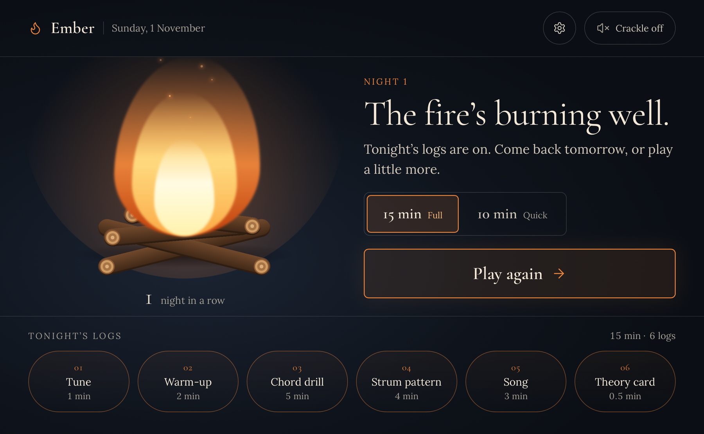

# Ember

**A nightly guitar practice session for beginners. Keep the fire alive.**

Ember is a personal web app for iPad that guides one short practice session every night: tune, warm up, learn chords, practise strumming, play a song, read one theory card. It listens to your guitar through the microphone and gives gentle, never punishing feedback.

**[Open the live app](https://ember-guitar.netlify.app)**



## The idea

Beginners lose momentum deciding what to practise. Ember removes that decision.

- One guided session per night: **15 min** (full) or **10 min** (quick).
- Every finished step adds a log to the campfire. The streak is the flame.
- Miss a day and the fire dims to embers. It never goes out, so there is no guilt.

## The nightly session

| Step | 15 min | 10 min |
| --- | --- | --- |
| Tune | 1 | 1 |
| Warm-up | 2 | skipped |
| Chord drill | 5 | 4 |
| Strum pattern | 4 | 3 |
| Song section | 3 | 2 |
| Theory card | 0.5 | shown on the summary |

## Features

- **Mic tuner**: auto-detects the string, tap to lock, glow tightens as you get closer.
- **Chord drill**: hold a chord for 2 seconds, then a change drill (e.g. G → C) that counts clean changes.
- **Strum patterns**: listen to the pattern, then play along to a metronome. Timing feedback is per bar: on time, a bit early, a bit late.
- **Songs**: chord-only progressions. A song unlocks once you know its chords.
- **Adaptive curriculum**: a new chord is added only after the current set has passed in 3 sessions. Strum patterns are rated 1 to 5.
- **Daily theory card**: one idea per day, no quiz.
- **Private by design**: audio is processed on the device. No account, no backend, nothing uploaded.
- **Installable and offline**: PWA, works from the iPad Home Screen.

## How the listening works

- **Tuner**: pitch detection (McLeod method) on 4096-sample windows, smoothed over the last 5 readings, restricted to guitar string frequencies to avoid octave errors.
- **Chord check**: the app always knows the target chord, so it checks the microphone signal against it (12-bin chromagram, cosine similarity against the chord's real open voicing). The target must win against the other learned chords by a margin. This is "close enough" feedback, not strict pass/fail.
- **Strum timing**: onset detection (spectral flux in an AudioWorklet) compared with the metronome on the same audio clock, with a one-time latency calibration.
- **Debug screen**: live input level, noise floor, pitch, chroma bars, chord scores and threshold sliders, used to tune on a real guitar.

## Design

- Campfire at night: charcoal-navy background, ember-orange accent, warm cream text.
- Large tap targets (56px minimum), readable from one metre away while holding a guitar.
- No red/green pass-fail. Feedback is warm glow versus soft dimming.
- Designed in Claude Design. Tokens are exported as CSS variables.

## Tech stack

- Vite, React, TypeScript
- Web Audio API (AudioWorklet), [pitchy](https://github.com/ianprime0509/pitchy) for pitch detection
- PWA (manifest, service worker)
- Content in JSON files (chords, patterns, songs, theory cards, warm-ups)
- No backend. Progress is stored locally.

## Getting started

```bash
npm install
npm run dev      # local development
npm run build    # static build in dist/
```

Microphone access requires **HTTPS**. `localhost` works on the same machine, but to test on an iPad you need to deploy `dist/` to a static host:

- [Netlify Drop](https://app.netlify.com/drop): drag the `dist` folder onto the page
- Cloudflare Pages
- GitHub Pages

## Install on iPad

1. Open the deployed URL in Safari.
2. Tap **Share**, then **Add to Home Screen**.
3. Launch it from the icon. iOS may ask for microphone permission on each launch.

## Project structure

```
src/
  audio/     mic input, pitch, chroma, onset, metronome, synth
  engine/    session state machine, curriculum rules, streak
  data/      chords, patterns, songs, theory, warm-ups (JSON)
  store/     persisted progress
  screens/   Home, Session shell, Tuner, Warm-up, Chord drill,
             Strum, Song, Theory, Summary, Debug
```

Screens talk to the audio layer through hooks (`useTuner`, `useChordCheck`, `useStrumTiming`, `useMetronome`) and never touch Web Audio directly.

## Roadmap

- [x] **M0** Mic spike: live pitch readout on iPad Safari
- [ ] **M1** Tuner, Debug screen, design tokens, Session shell
- [ ] **M2** Metronome, Strum screen, onset feedback, latency calibration
- [ ] **M3** Chord drill (hold and change drill)
- [ ] **M4** Session engine, Home, Summary, storage, streak
- [ ] **M5** Warm-up, Song section, Theory card, curriculum rules
- [ ] **M6** PWA polish: offline, wake lock, export/import progress

## Known limitations

- Chord detection is approximate and tuned for open chords on an acoustic guitar.
- Strum timing depends on device latency. Use headphones for the click to avoid it leaking into the microphone.
- Progress lives in the browser. Installing as a Home Screen app avoids Safari's 7-day storage cleanup, and an export/import option is planned.

## License

Personal project. No license specified yet.
